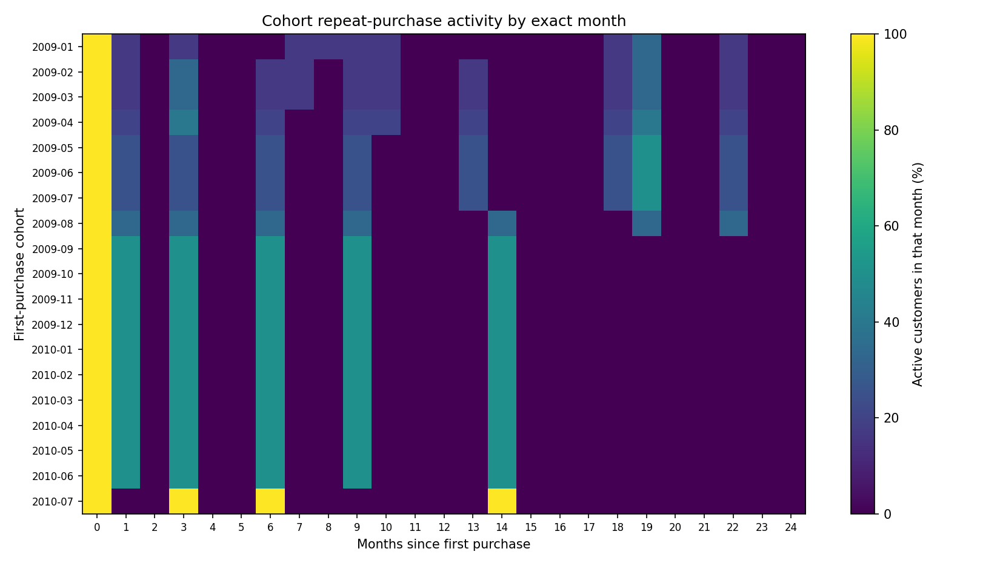
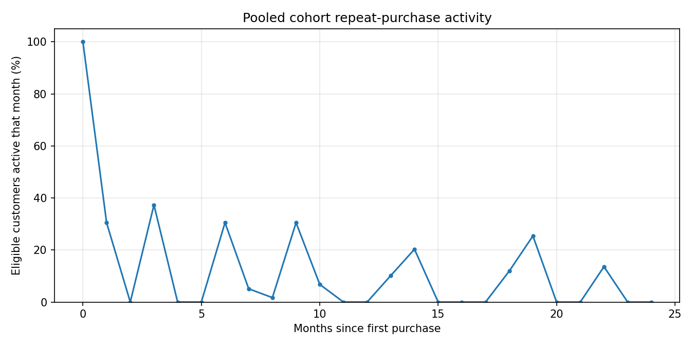
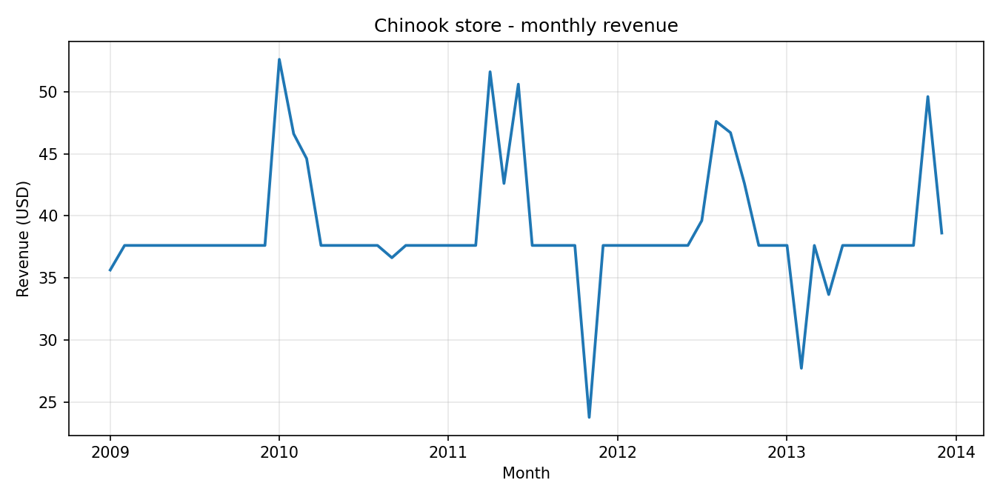

# SQL Business Analysis: Chinook Music Store

[](https://github.com/AhmadEblagh205/sql-business-analysis/actions/workflows/ci.yml)


An end-to-end SQL analysis of the **[Chinook 1.4.5](https://github.com/lerocha/chinook-database) sample database**. The project answers commercial-style questions with joins, CTEs, window functions and a recursive cohort spine, then uses a small Python runner to export reproducible reports and figures.

> **Data provenance:** Chinook is a demonstration database, not a real store history. Its upstream documentation describes the customer/employee records as fictitious and the sales history as auto-generated sample data. The findings below demonstrate analytical method rather than real commercial performance.

## What the analysis asks

1. Which genres account for the most US track sales?
2. How do support agents compare on total revenue **and revenue per assigned customer**?
3. How does revenue vary by country when one-customer markets are grouped into `Other`?
4. Do invoices contain complete albums or individual-track baskets?
5. How does monthly revenue evolve across the sample period?
6. Which countries generate more revenue per customer than the store average, and how concentrated is that revenue?
7. What does customer repeat-purchase activity look like by first-purchase cohort?
8. What is the pooled repeat-purchase activity curve after accounting for right-censoring of newer cohorts?

## Findings worth discussing

- **Rock accounts for 31.8% of US track units** in the sample.
- **99.5% of invoices are classified as individual-track purchases**, with only 2 full-album invoices.
- **Jane Peacock leads total sales ($833.04), while Steve Johnson has the highest sales per assigned customer ($40.01 vs Jane's $39.67).** That distinction is why the revised project reports both scale and a portfolio-size-normalised measure rather than calling raw totals “agent performance”.
- The Czech Republic has the largest country value index (**1.14**) among markets with at least two customers, but it contains only two customers and its top customer contributes **55%** of country revenue. The ranking therefore comes with an explicit concentration warning.
- Cohort “retention” is deliberately reframed as **exact-month repeat-purchase activity**. The pooled sample is active at **30.5% in month 1 and 37.3% in month 3**; a non-monotonic curve is possible because customers can skip a month and return later.







## Why the cohort query changed

The original query returned only months in which somebody purchased. A line chart could therefore connect across missing months without making the zero activity explicit. The revised query uses a recursive CTE to create every eligible month offset and left-joins observed activity onto it, so zero-activity periods are genuine rows.

It also distinguishes **period activity** from survival-style retention: somebody can be inactive at month 2 and return at month 3. See [`docs/METHODOLOGY.md`](docs/METHODOLOGY.md) for the exact definitions and query-grain discussion.

## Running it

```bash
pip install -r requirements.txt
python src/download_data.py     # pinned Chinook v1.4.5 + schema/integrity checks
python src/run_analysis.py      # runs every query, writes CSVs and figures
pytest -q
```

Each query lives in its own file under `sql/`, so it can be reviewed independently of the Python runner. Raw databases remain git-ignored.

## Repository layout

```text
sql/                    eight standalone analytical queries
src/download_data.py    pinned sample-data acquisition + validation
src/run_analysis.py     query orchestration + figures
reports/                reproducible CSV outputs
reports/figures/        generated analytical figures
docs/METHODOLOGY.md     definitions, grain, caveats and test semantics
tests/                  in-memory SQL regression tests
```

## Tests

The test suite creates a small in-memory Chinook-like database and checks that **all eight SQL files execute**, then pins the subtle logic that is easiest to get wrong: portfolio-size normalisation, zero-filled cohort months, right-censoring, album classification and monthly aggregation. CI runs on every push.

## Licence

Project code is MIT licensed; see [LICENSE](LICENSE). Chinook data remains subject to the upstream project's licence.
